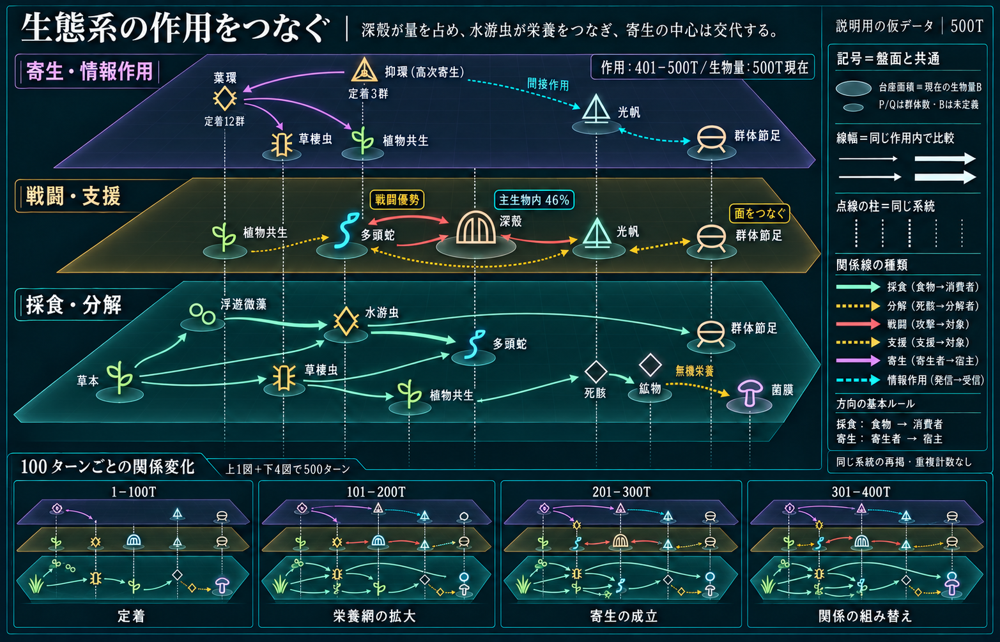

# 関係面の表示モックとA/B対応

今回の採用内容を図にした説明用資料。製品画面のスクリーンショットや生態検証の証跡ではない。現行UI全体の変更、造形の差し替え、外観承認を意味しない。

## 読み方

- 上は401–500Tの大きな関係面。下は1–100T／101–200T／201–300T／301–400Tの4小図。合計500T・5区間で、最終区間は重複させない。
- 採食/分解、戦闘/支援、寄生/情報作用を3面に分ける。同一系統を面ごとに再掲し、無方向の中立線で対応させる。
- 生物記号は盤面定義を参照。身体Bがある対象だけ台座面積で示し、P/Qは群体/定着の単位を使う。多数派と作用の担い手を分ける。
- 色線は実作用を説明する仮の関係。文章は総括1文を基本とし、細かな数値・単位・期間は説明欄へ置く。

## 正本と責務

| 対象 | Node | 正本 |
| --- | --- | --- |
| 数/B/関係・寄生・食性の意味 | A1.7 | [関係面仕様](../specification/relationship-network-v1.md) |
| 表示/実行条件と最大軽減 | A2 | [処理軽減仕様](../specification/display-load-reduction-v1.md) |
| 観察操作の接合 | B5 | 関係面仕様・処理軽減仕様 |
| 図の説明と数値/期間 | B5.2 | 関係面仕様 |
| 演出/マークの独立省略 | B5.3 | 処理軽減仕様 |
| 区間要約と境界値の最終保存 | B5.4 | 関係面仕様 |
| 3面・100T・共通記号と全期間グラフ | B5.5 | 関係面仕様 |

既存の円グラフ・生物量ピラミッド・右側3グラフは[統合サマリ仕様](../specification/ecosystem-summary-v1.md)を維持し、この部分だけを改善する。処理軽減欄の配置/各設定は本文を正とし、この画像から未指定の操作を追加しない。

## 画像の限界

画像生成による模式図のため、接続端・記号・文字の細部は製品用の厳密データではない。系統や食性、寄生対象、量、時間の正本は仕様本文と既存の生態/描画定義。画像の誤接続から光合成生産者の捕食、架空の無機養分還元、Qの宿主変更やBを追加しない。

今回画像では上1図/下4図と100T区間の構成を照合した。下層の一部資源接続、面間対応線、小図の記号・色の完全一致には生成上のずれが残る。これらは採用済み生態条件ではなく、製品では共通記号と観測データから直接描画する対象。本文の接続・単位を優先し、画像をそのまま動作図や製品素材へ転用しない。

後続は[接続契約](../../operations/plans/ui-network-review-v1.md)。今回の文書照合は `operations/logs/ui-network-review-v1.md` に記録する。
