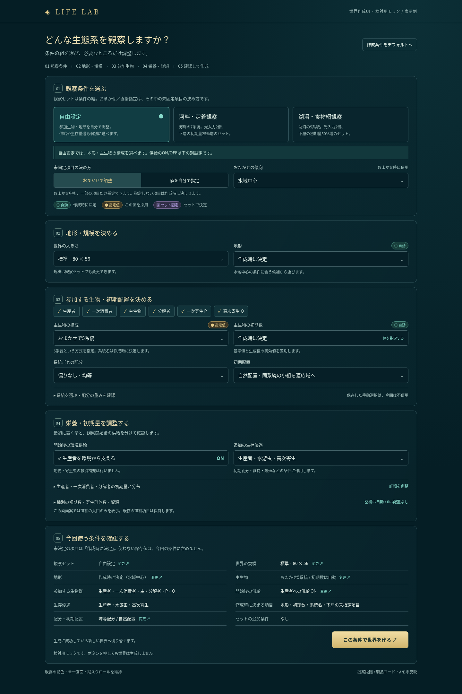
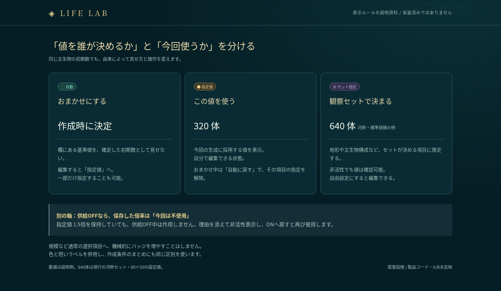

# 世界作成UI：優先3点の画面構成案 / 2

状態：優先3点を採用。設計モックの基点はmain `035f796`、製品4.2.74。製品接続の正本は[設定の意図/2](../specification/setup-intent-v2.md)、実画面・結果は[限定証跡](../../operations/evidence/setup-intent-v2/README.md)。以下の画像とpreview-check/review-gateは採用前の説明モックの記録であり、製品実画面ではない。

- [全体画面](overview.png)：自由設定＋おまかせの代表例。既存配色、単一画面の縦スクロール、5区画を維持する。
- [3種類の値と不使用の区別](states.png)：自動／指定値／セット固定、別軸としての「今回は不使用」を示す。
- [操作できる説明モック](mock.html)：単体HTML。ブラウザで開き、3つの観察セットと未固定項目の決め方を切り替えられる。世界生成は行わない。数値・状態は説明用の代表例。

## 1. 決める順序を明確にする

画面は①観察条件→②地形・規模→③参加生物→④栄養・詳細→⑤作成のまま。最初の3つの操作には異なる役割を与える。

| 現行ID・値 | 表示案 | 意味 |
| --- | --- | --- |
| observation-mode / custom, river-settlement, lake-foodweb | 観察セット | 自由設定／河畔・定着／湖沼・食物網。既存の条件の組を選ぶ |
| generation-mode / auto, manual | 未固定項目の決め方 | おまかせで調整／値を自分で指定。セットで固定されない項目に適用 |
| generation-profile / 既存の傾向 | おまかせの傾向 | おまかせ時だけ使用。直接指定時も非活性のまま確認可能 |

自由設定は「供給なし」を意味しない。供給ON/OFFと生存優遇は別の明示設定として維持する。

河畔・湖沼セットで固定されるのは地形、主生物数、参加群・系統、配分、配置、餌保証。規模は選べ、主生物数は規模から既存式で決まる。供給・優遇・未固定の下層条件まで一律に編集禁止にしない。基点のapplyObservationMode/syncGenerationFieldsの意味を変えない。

セットカードの説明は「何が固定されるか」「どんな条件を観察するか」を短く表示。河畔は7系統、湖沼は5系統、光入力2倍、下層初期量はそれぞれ25%/50%増という現行条件を参照する。生存や優勢になる結果を保証する説明にはしない。

## 2. 値の由来と使用状態を分ける

値の由来は3種類。全入力へ機械的にバッジを付けず、既存generationFields/セット固定の対象だけで使う。サイズなど通常の選択項目はそのままとする。

| バッジ | 判定 | 欄と操作 |
| --- | --- | --- |
| 自動 | おまかせ＋その項目のロックなし＋セット固定なし | 未決定の実効値を断言しない。「作成時に決定」。参照する基準値は詳細に「基準」と明記。編集したら指定値になる |
| 指定値 | 直接指定、またはおまかせでその項目だけロック済み | 採用する値を表示。おまかせ中は「この値を使う」／「自動に戻す」で既存ロックを操作 |
| セット固定 | 観察セットがその項目を決める | 実際のセット値を非活性表示。「自由設定にすると編集可能」と案内。自由設定へ切り替えただけで実効値の保存・ロック規則を変えない |

地形の「おまかせ」は候補から選ぶ指定で、地形の具体名が確定したものではない。直接指定モードでも地形がおまかせなら、まとめには「候補から作成時に決定」と書く。

別軸の不使用例：供給OFF時、供給倍率の入力値は保持するが適用しない。「供給OFFのため今回は不使用」と欄の上へ表示。供給倍率は自動生成ロックの対象ではないため、この例だけで由来バッジの対象を増やさない。グレーだけで理由を伝えない。無効な生物群の初期数、直接指定時の傾向、手動構成を使わないときの保存済み系統選択も同じ区別にする。種別初期数の空欄＝自動、明示0＝配置なしを維持する。

地形変更により既存挙動が傾向をおまかせへ戻した場合は、その変更を欄の近くで短く知らせる。新しい自動補正や確認ダイアログは加えない。

## 3. 作成直前に「今回使う条件」をまとめる

⑤には入力値の羅列ではなく、今回の有効な条件だけを表示する。

- 観察セット、規模、地形の決定方法。
- 主生物の構成方法・系統数・初期数、配分・初期配置。未確定の系統名や実配置数は作らない。
- 参加する生物群、初期量の変更、開始後の供給ON/OFF、生存優遇。
- おまかせで決まる項目と自分で指定した項目を区別。供給OFF時の保存倍率などは条件として加算しない。
- 各要約の「変更」から元の区画へスクロール。ページを切り替えず、閉じた詳細なら開いて対象へ移動。

例示：自由＋おまかせ＋水域中心では「地形：作成時に決定」「主生物：おまかせ5系統」「初期数：作成時に決定」。河畔セット・80×56では「地形：河畔」「主生物：7系統・640体（設定上の初期数）」で、生成後の配置実績と混同しない。最低人数・地形容量・宿主枠の検査は既存契約を維持する。

ボタンは末尾の「この条件で世界を作る」。生成中は二重作成を防ぎ、成功するまで現在世界を保持する。「デフォルトへ戻す」は作成条件だけを戻し、図鑑・現世界・表示設定を変更しない。既存の取消導線とエラー修正先を維持する。

## 4. 今回の優先範囲と後続

今回のモックは上記3点。地形サムネイル、全生物群ごとの詳細欄の再編、詳細係数の全面説明は後続案であり、このモックを全設定の完全画面としない。④は詳細の入口を圧縮して示し、隠れた入力を廃止しない。モックはゲームを動かさず、操作例は仮データ。

A1/B5・C8と関連D9/E6の既存責務へ接続する。新しいNode/分割は行わず、既存入力ID/値/制約/実効条件/取消保護を維持する。

## 参考と読解範囲

公開UIコードの比較。ゲーム本体のプレイ比較・画面撮影をしたという意味ではない。

- [Thrive：基本・詳細の分離](https://github.com/Revolutionary-Games/Thrive/blob/c9b1375ac6740e368595a772dc18b692a9998fe9/src/general/NewGameSettings.cs#L615)。基本の選択から必要な詳細へ進める点を参照。
- [OpenTTD：世界生成の条件付き設定](https://github.com/OpenTTD/OpenTTD/blob/master/src/genworld_gui.cpp)。地形等の条件に応じた利用可否を参照。
- [Freeciv：シナリオ選択と説明の併置](https://github.com/freeciv/freeciv/blob/main/client/gui-qt/pages.cpp#L584)。選択と説明を近くに置く点を参照。
- 現行正本：../specification/setup-flow-v1.md。実装：../../src/app.jsのapplyObservationMode、syncGenerationFields、readConfig、syncSetupNotes。現行画面：../../src/Index.html。採用する範囲は設定の意図/2を参照する。
