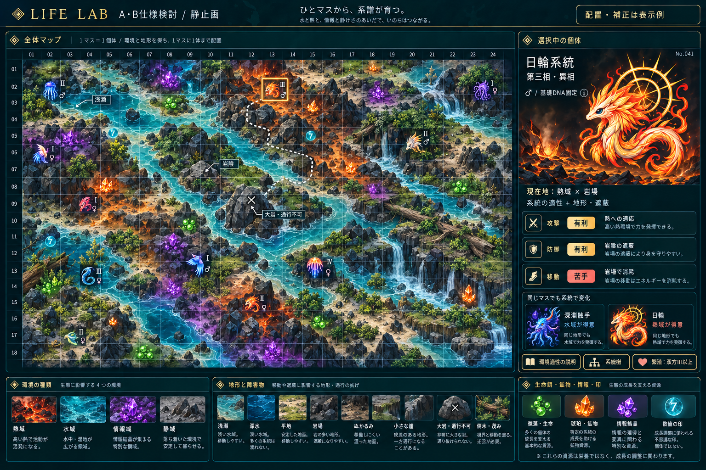
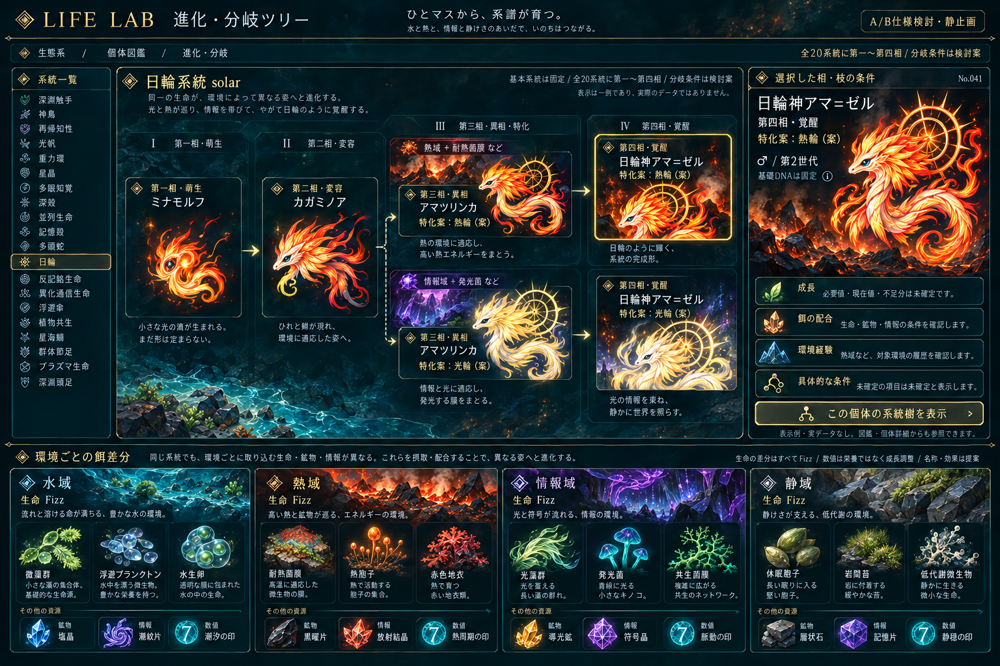
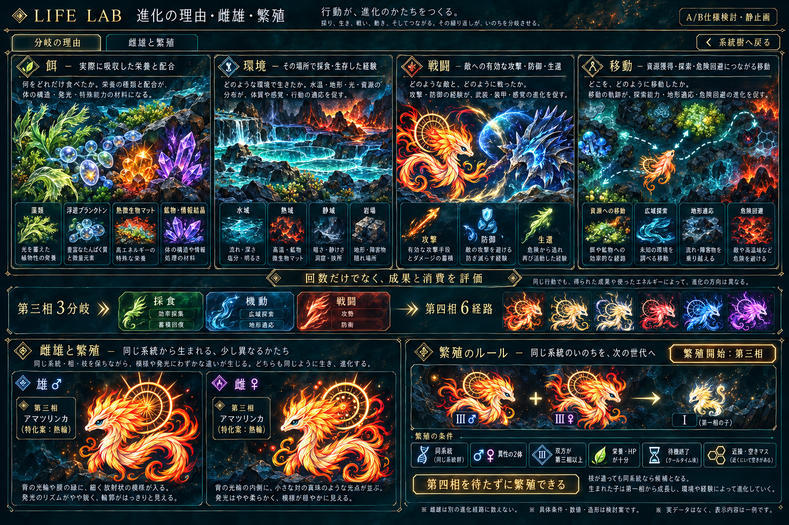

# A仕様・B機能の検討資料

[全20系統：第三相3枝→第四相6経路](evolution-trees/README.md) / [分岐ロジック](branching-rules.md) / [雌雄と第三相からの繁殖](sex-and-reproduction.md) / [環境別の餌](environment-food.md)

## 局所経験と系統戦略（最新）

[六つの行動・継承・情報伝達・計算量](local-strategy.md)。系統の基本傾向と個体の経験を使い、群れは近傍の協調から生じさせる。1ターンO(N+I)を目標とする仕様上の見積もりで、実測ではない。A1.4/B4.1の分割はユーザー確認済み。

## 最新のゲームの軸

[数字・情報を食べる生命と、餌・生物・環境のライフゲーム基盤](life-rule-foundation.md)。近傍8マス・同期更新を共通基盤とし、餌/環境のB3/S23と生物の密度負荷を区別し、第三相からの雌雄繁殖や環境適性を追加条件として整理する。具体的な近傍則は提案段階。

## 全体マップの静止画（最新）

[20系統の得意/苦手と地形](habitat-adaptation.md) / [情報の餌とライフゲームによる生成](food-cellular-rules.md)

全体マップを主役にする。画像は表示案で、餌のセル更新・移動経路・能力補正の実測ではない。

## 分岐図画面の静止画

## 説明シートの静止画

[系統樹の機能B5.1](in-game-evolution-viewer.md) / [説明シートの機能B5.2](explanation-sheets.md)

現在はA/Bと静止画のみ。分岐数・第三相からの繁殖・小さな雌雄差はユーザー指定。分類名・評価方法・条件の数値・新しい造形は具体化の提案。元FizzBuzzの四相・名称・基本系統を保持し、既存素材ですべての新しい枝の姿が完成済みとは扱わない。実装再開はユーザー許可待ち。
