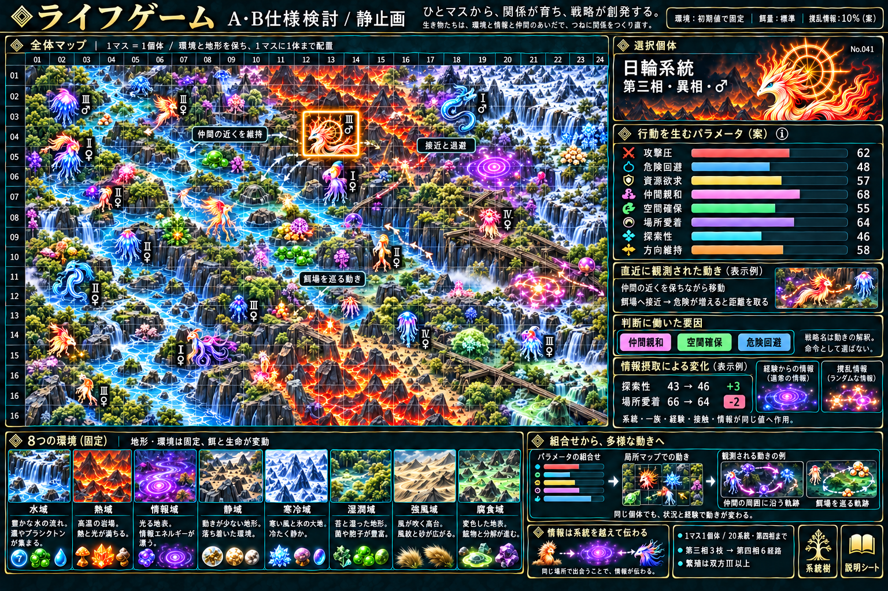

# ライフゲーム：A仕様・B機能の検討資料

[現在の仕様まとめ](design-summary.md) / [具体化仕様v2](concrete-rules-v2.md) / [戦略の考え方](local-strategy.md)

戦略は固定モードから選ばず、本人の9パラメータと局所条件から基本動作を直接決める。その結果を集団形成・護衛・追跡・分散・周回等に見える動きとして観測する。これらの戦略名は制御命令ではない。

[固定8環境](environment-expansion.md) / [餌と量の表現](environment-food.md) / [餌の近傍更新](food-cellular-rules.md) / [進化3→6](evolution-trees/README.md) / [雌雄と繁殖](sex-and-reproduction.md)

実装・C/D/E・動作検証は行っていない。画像・数値・観測は草案/表示例。旧資料と画像は以前の検討記録で、最新表示と判断はv2を優先する。

ランダム性を追加した最新仕様は[具体化仕様v2](concrete-rules-v2.md)。画像の8本のパラメータ表示は追加前の見本。ランダム性はモードではなく、他の要因と混ざる再現可能な揺らぎ。

[植物・動く餌・餌ごとの特色（最新）](food-ecology.md)：13種の役割、栄養、量、更新周期を整理。既存画像は追加3種/移動の全表現を示したものではない。
