# 生態シミュレーション：図解資料 詳細補完版 v1.2

**図解69枚＋表紙。全体版70ページ、追加分だけの別冊15ページ。** 前版55図で不足していた戦闘・移動・餌の規則を、比較・数値例・不成立例を含む14図で補った。ゲーム画面や動作検証の資料ではない。

[追加14図だけの別冊PDF](ecology-detail-supplement-v1.2.pdf) / [全体版PDF](ecology-ab-atlas-v1.2.pdf) / [49項目の照合](detail-coverage-v1.2.md) / [規範本文の入口](../README.md)

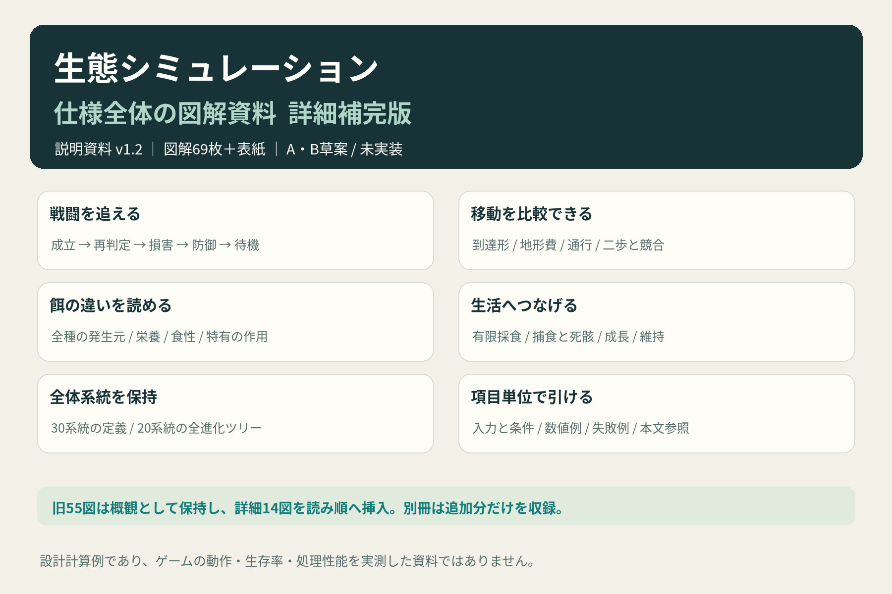

## 読み方

新しい全体版は詳細図を関連する概観へ挿入している。資料IDとPDFページは別。旧01〜55の画像は保持しており、以下で同じIDを引ける。厳密な式は正本・系統表・実行条件・[今回の適用先補足](../ab-detail-clarifications-v1.2.md)を併読する。

## 戦闘・移動・環境の詳細

| 資料ID | 個別画像 | 全体版ページ | 別冊ページ |
|---|---|---|---|
| 56 | [戦闘の成立・防御・待機・同時確定](56-combat-resolution.png) | 21 | 2 |
| 57 | [攻防式・防御姿勢・遠隔・損害按分の数値例](57-combat-damage-examples.png) | 22 | 3 |
| 58 | [環境適性・固有発現率・移動費の比較](58-environment-multipliers.png) | 23 | 4 |
| 59 | [一歩/二歩の到達・角抜け・崖・枠の通行条件](59-movement-legality.png) | 24 | 5 |
| 60 | [地形別の移動費・二歩予算・予約取消](60-movement-costs.png) | 25 | 6 |

## 餌・栄養・捕食の詳細

| 資料ID | 個別画像 | 全体版ページ | 別冊ページ |
|---|---|---|---|
| 61 | [植物3系統と菌膜の違い・栄養・回復](61-plants-and-fungus.png) | 10 | 7 |
| 62 | [動く餌2系統の移動・繁殖・生息域の比較](62-moving-prey.png) | 11 | 8 |
| 63 | [脱落餌4種の発生元・食性・回復適性](63-organic-foods.png) | 12 | 9 |
| 64 | [鉱物2種・代謝因子・情報の役割と量](64-minerals-factors-information.png) | 13 | 10 |
| 65 | [食性5型と吸収効率・生物群ごとの例外](65-diet-and-absorption.png) | 14 | 11 |
| 66 | [二口採食・回復配分・有限Bの競合](66-feeding-competition.png) | 18 | 12 |
| 67 | [捕食から有限死骸・寄生移行までの時系列](67-predation-and-carcass.png) | 34 | 13 |

## 行動と生活規則の詳細

| 資料ID | 個別画像 | 全体版ページ | 別冊ページ |
|---|---|---|---|
| 68 | [局所特徴と負傷による行動得点の比較](68-behavior-score-examples.png) | 27 | 14 |
| 69 | [密度維持・栄養不足・成長・容量・待機](69-state-and-lifecycle.png) | 69 | 15 |

## 世界・入力・状態

| 資料ID | 個別画像 | 全体版ページ | 別冊ページ |
|---|---|---|---|
| 17 | [仕様全体：30系統と相互作用](17-ecosystem-overview.png) | 2 | — |
| 18 | [初期設定・比較モード・配置不足](18-initial-conditions.png) | 3 | — |
| 11 | [固定環境・地形・初期配置](11-environment-terrain.png) | 4 | — |
| 01 | [占有枠と宿主内階層](01-cell-layers.png) | 5 | — |
| 19 | [個体状態・DNA・出生基準の継承](19-state-and-inheritance.png) | 6 | — |

## 生産・餌・資源の概観

| 資料ID | 個別画像 | 全体版ページ | 別冊ページ |
|---|---|---|---|
| 02 | [有限栄養と材料還元](02-nutrient-budget.png) | 7 | — |
| 03 | [生きた餌と資源の特色](03-food-identities.png) | 8 | — |
| 13 | [光合成・菌・動く餌の6系統](13-producers-and-prey.png) | 9 | — |
| 14 | [環境差・残量差による餌の静止表現](14-resource-appearance.png) | 15 | — |
| 22 | [B3/S23・生物出生・有限資源の違い](22-cellular-rules.png) | 16 | — |
| 21 | [動作予算・維持・二口採食・回復](21-payment-and-feeding.png) | 17 | — |

## 同期進行・行動・情報の概観

| 資料ID | 個別画像 | 全体版ページ | 別冊ページ |
|---|---|---|---|
| 20 | [10段階の同期進行と確定点](20-turn-sequence.png) | 19 | — |
| 09 | [同時移動と独立した感知・射程](09-sensing-movement-combat.png) | 20 | — |
| 10 | [多様な行動が生じる局所評価](10-emergent-behavior.png) | 26 | — |
| 23 | [本人学習・接触学習・固定長記憶](23-learning-and-memory.png) | 28 | — |
| 08 | [高次寄生と延長された表現型](08-hyperparasite-information.png) | 29 | — |
| 25 | [情報の費用・鮮度・文脈・撹乱](25-information-lifecycle.png) | 30 | — |

## 寄生・成長・繁殖

| 資料ID | 個別画像 | 全体版ページ | 別冊ページ |
|---|---|---|---|
| 07 | [短い・長い寄生生活環と移行失敗](07-parasite-cycles.png) | 31 | — |
| 16 | [一次・高次寄生の宿主別代表形態](16-parasite-forms.png) | 32 | — |
| 26 | [寄生の成熟・費用・子候補・失効](26-parasite-contract.png) | 33 | — |
| 04 | [四相・三相・実成果による分岐](04-growth-branches.png) | 35 | — |
| 24 | [相の閾値・分岐実績・最終枝効果](24-growth-thresholds.png) | 36 | — |
| 05 | [有性・単為・無性と出生配分](05-reproduction.png) | 37 | — |
| 06 | [真社会性と局所共同育児](06-eusociality.png) | 38 | — |
| 15 | [早成甲殻の三相と雌雄の小さな外形差](15-precocial-and-sex.png) | 39 | — |

## 全系統の定義

| 資料ID | 個別画像 | 全体版ページ | 別冊ページ |
|---|---|---|---|
| 34 | [早成甲殻の数値プロファイル](34-precocial-profile.png) | 40 | — |
| 35 | [生産者・菌・小型6系統の数値一覧](35-food-species-profiles.png) | 41 | — |
| 29 | [主20系統の特性一覧 01〜04](29-main-profiles-01-04.png) | 42 | — |
| 30 | [主20系統の特性一覧 05〜08](30-main-profiles-05-08.png) | 43 | — |
| 31 | [主20系統の特性一覧 09〜12](31-main-profiles-09-12.png) | 44 | — |
| 32 | [主20系統の特性一覧 13〜16](32-main-profiles-13-16.png) | 45 | — |
| 33 | [主20系統の特性一覧 17〜20](33-main-profiles-17-20.png) | 46 | — |

## 20系統の進化ツリー

| 資料ID | 個別画像 | 全体版ページ | 別冊ページ |
|---|---|---|---|
| 36 | [深淵触手：四相・3枝・6経路](36-tree-abyss.png) | 47 | — |
| 37 | [神鳥：四相・3枝・6経路](37-tree-myth.png) | 48 | — |
| 38 | [再帰知性：四相・3枝・6経路](38-tree-recursive.png) | 49 | — |
| 39 | [光帆：四相・3枝・6経路](39-tree-sail.png) | 50 | — |
| 40 | [重力環：四相・3枝・6経路](40-tree-gravity.png) | 51 | — |
| 41 | [星晶：四相・3枝・6経路](41-tree-crystal.png) | 52 | — |
| 42 | [多眼知覚：四相・3枝・6経路](42-tree-manyeyes.png) | 53 | — |
| 43 | [深殻：四相・3枝・6経路](43-tree-abyssshell.png) | 54 | — |
| 44 | [並列生命：四相・3枝・6経路](44-tree-parallel.png) | 55 | — |
| 45 | [記憶殻：四相・3枝・6経路](45-tree-memory.png) | 56 | — |
| 46 | [多頭蛇：四相・3枝・6経路](46-tree-serpent.png) | 57 | — |
| 47 | [日輪：四相・3枝・6経路](47-tree-solar.png) | 58 | — |
| 48 | [反記銘生命：四相・3枝・6経路](48-tree-antimeme.png) | 59 | — |
| 49 | [異化通信生命：四相・3枝・6経路](49-tree-valis.png) | 60 | — |
| 50 | [浮遊傘：四相・3枝・6経路](50-tree-jelly.png) | 61 | — |
| 51 | [植物共生：四相・3枝・6経路](51-tree-kelp.png) | 62 | — |
| 52 | [星海鯨：四相・3枝・6経路](52-tree-whale.png) | 63 | — |
| 53 | [群体節足：四相・3枝・6経路](53-tree-swarm.png) | 64 | — |
| 54 | [プラズマ生命：四相・3枝・6経路](54-tree-plasma.png) | 65 | — |
| 55 | [深淵頭足：四相・3枝・6経路](55-tree-cephalopod.png) | 66 | — |

## 観測・モーション・成立条件

| 資料ID | 個別画像 | 全体版ページ | 別冊ページ |
|---|---|---|---|
| 27 | [観測操作・チェックポイント・表示密度](27-observation-and-scale.png) | 67 | — |
| 12 | [移動・攻撃・採食の静止絵コンテ](12-motion-storyboards.png) | 68 | — |
| 28 | [不成立理由・初回範囲・残る評価](28-failures-and-boundaries.png) | 70 | — |

## 追加された詳細図

### 56 戦闘の成立・防御・待機・同時確定

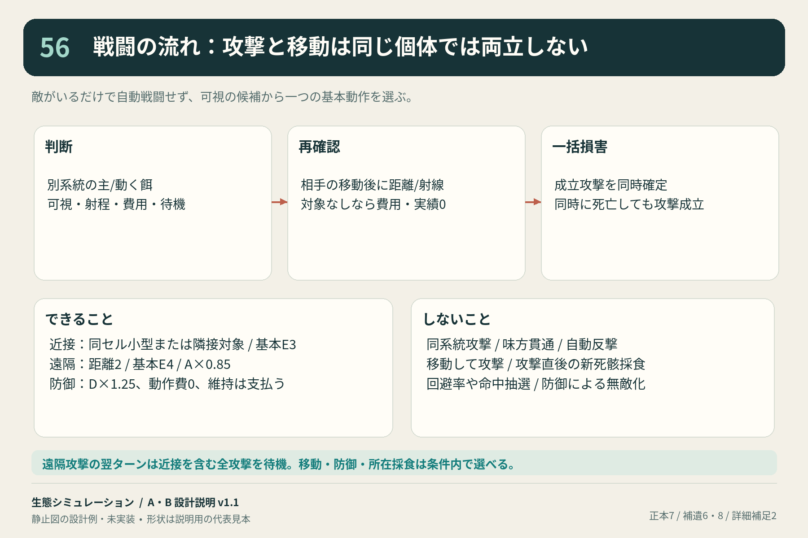

### 57 攻防式・防御姿勢・遠隔・損害按分の数値例

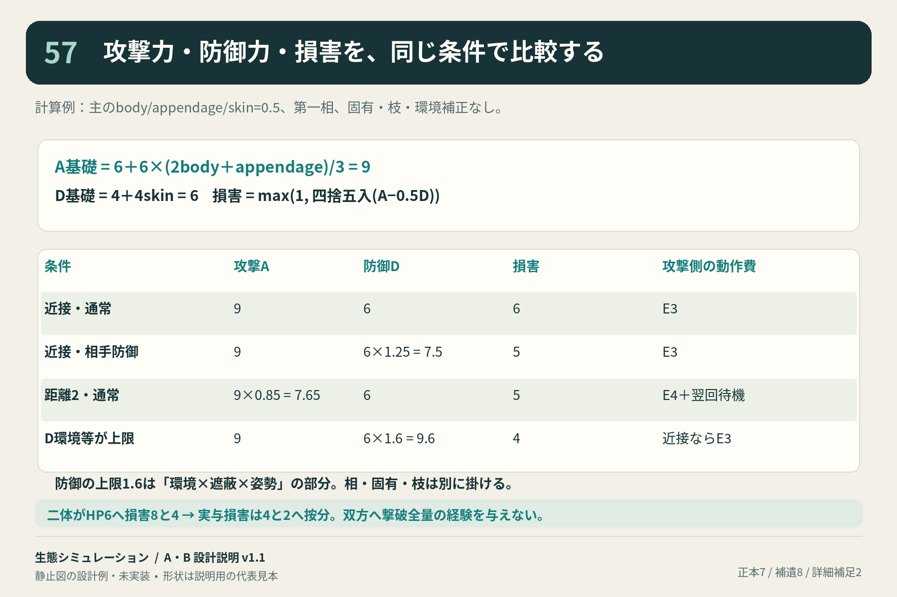

### 58 環境適性・固有発現率・移動費の比較

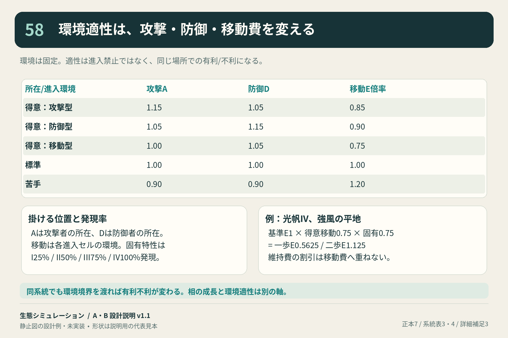

### 59 一歩/二歩の到達・角抜け・崖・枠の通行条件

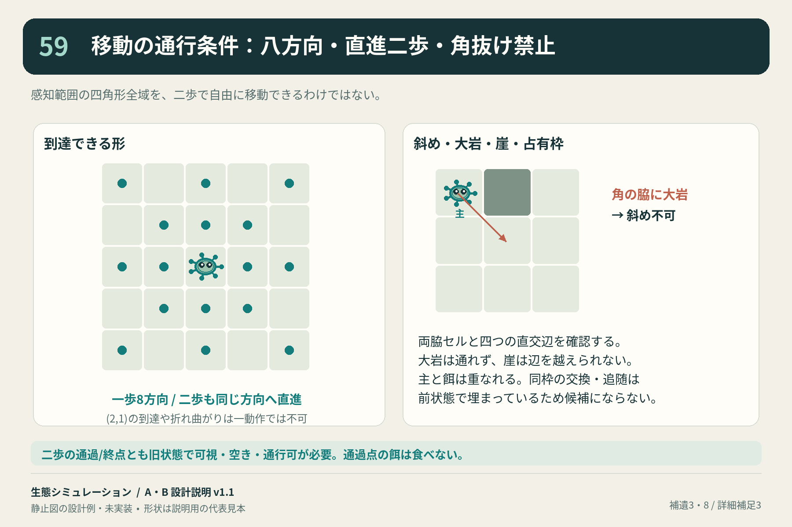

### 60 地形別の移動費・二歩予算・予約取消

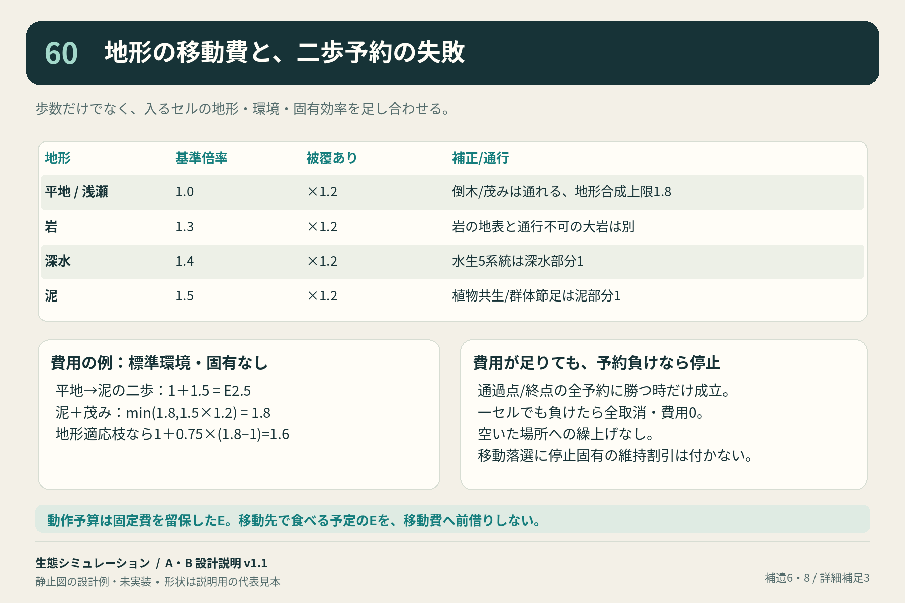

### 61 植物3系統と菌膜の違い・栄養・回復

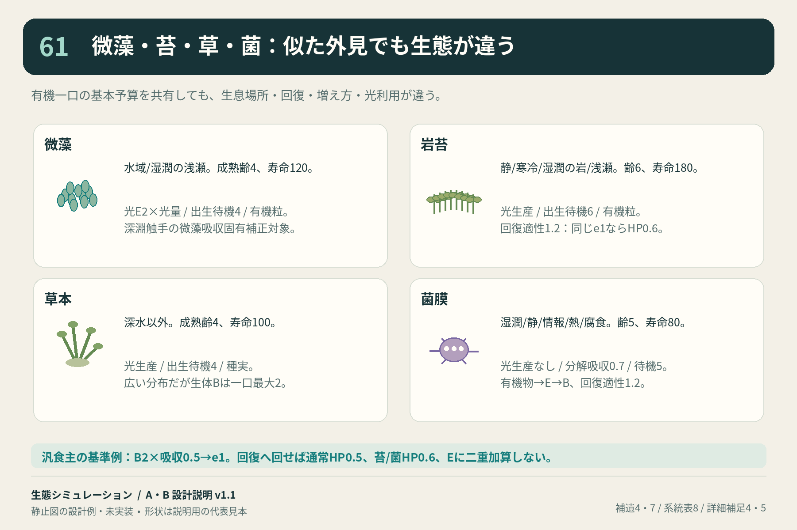

### 62 動く餌2系統の移動・繁殖・生息域の比較

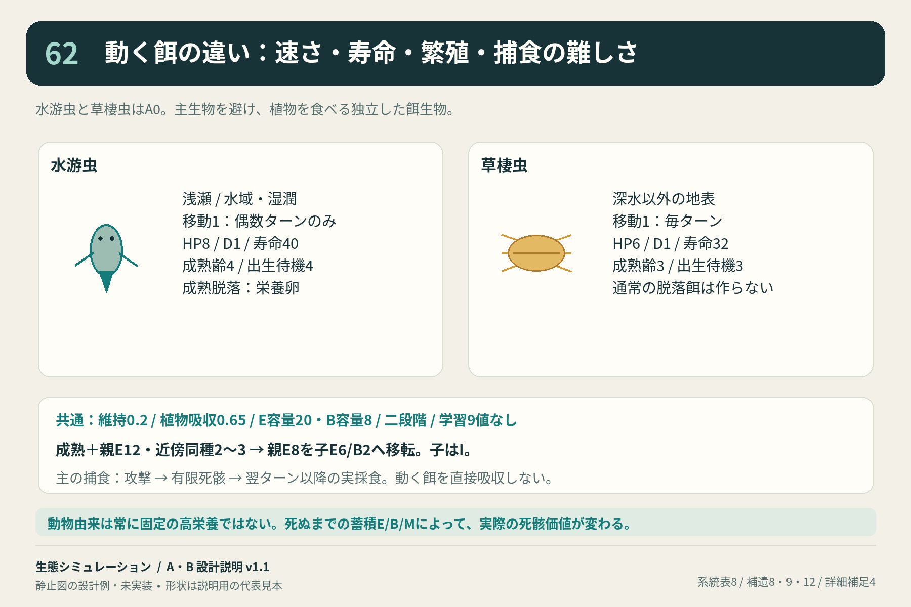

### 63 脱落餌4種の発生元・食性・回復適性

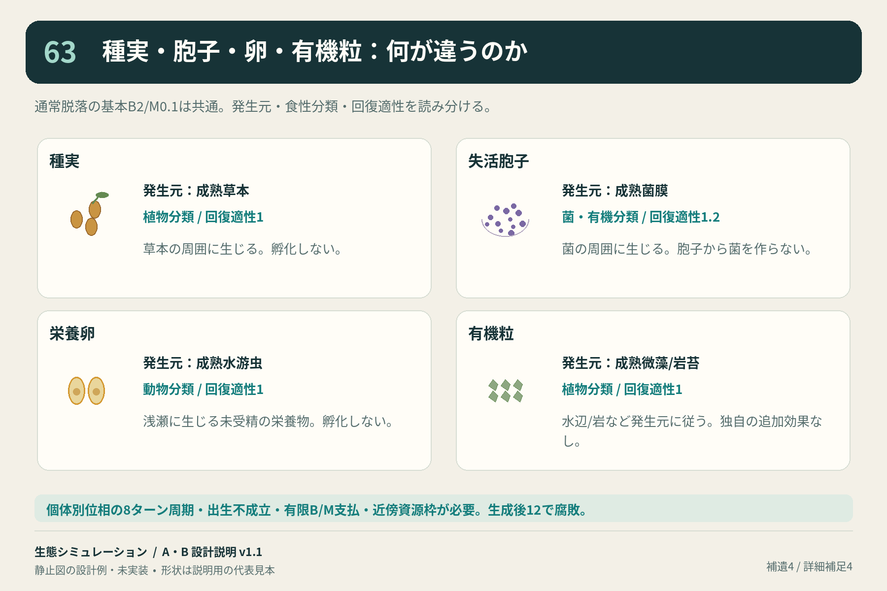

### 64 鉱物2種・代謝因子・情報の役割と量

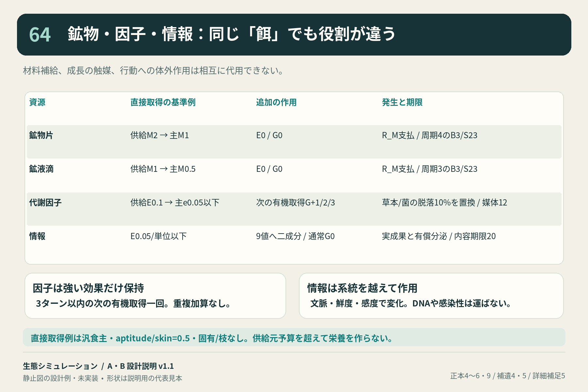

### 65 食性5型と吸収効率・生物群ごとの例外

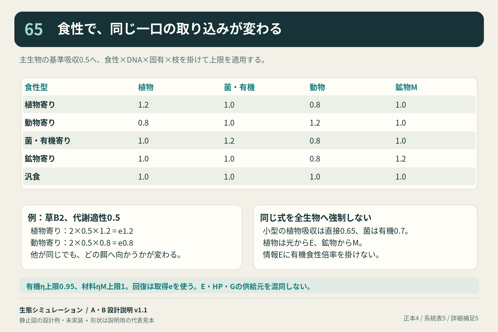

### 66 二口採食・回復配分・有限Bの競合

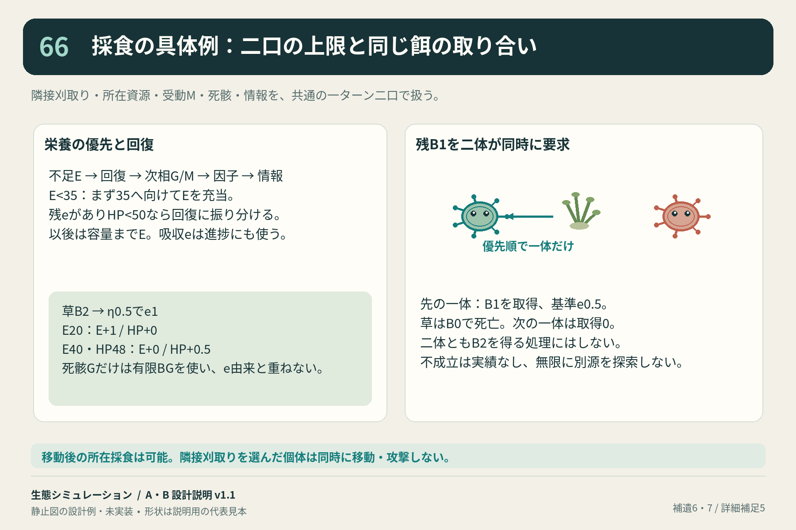

### 67 捕食から有限死骸・寄生移行までの時系列

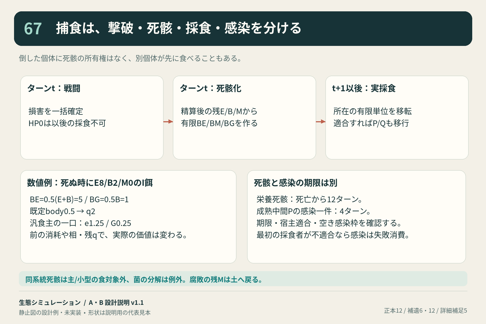

### 68 局所特徴と負傷による行動得点の比較

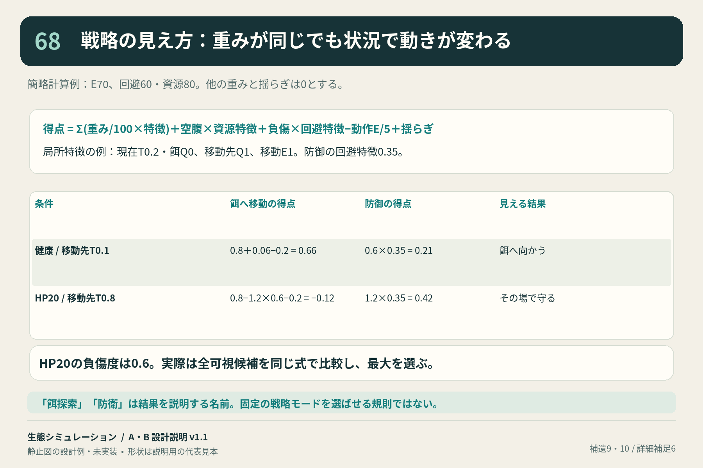

### 69 密度維持・栄養不足・成長・容量・待機

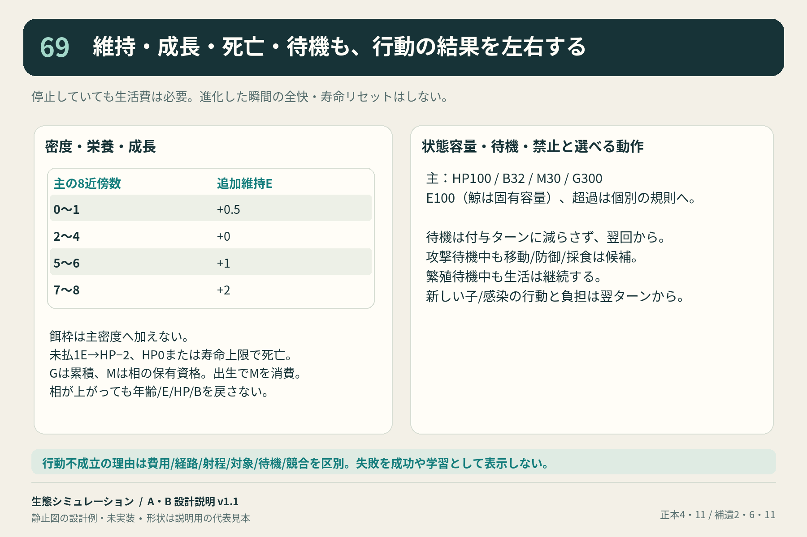

## 版と完成範囲

旧[56ページPDF](ecology-ab-atlas-v1.1.pdf)は前版の概観として保存。現行の説明入口は本書とv1.2のPDF。前版の章対応だけを根拠に詳細説明が十分とした判断を修正した。

図解とA/B文書を修正し、ゲーム実装・C/D/E・テスト・CIは進めていない。生存/繁殖/寄生持続/性能は未検証。全Nodeは草案のまま。
