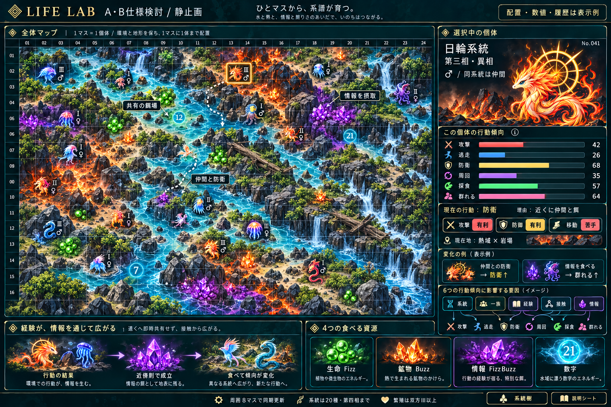
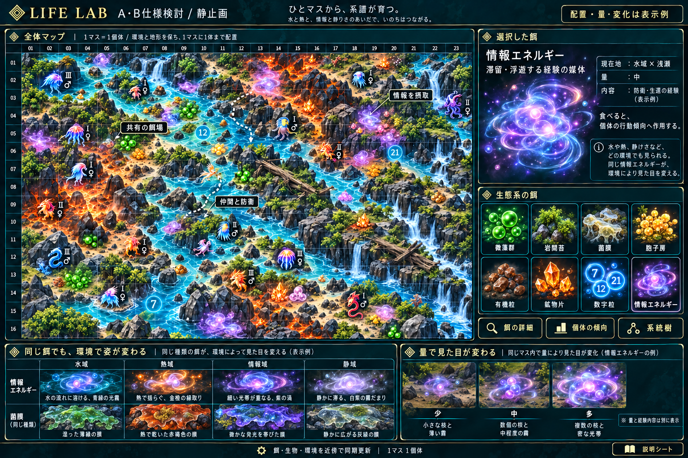

# LIFE LAB：A仕様・B機能のまとめ

## ゲームの軸

初期値から生まれたFizzBuzzの生命が、数字・情報などを食べ、環境と他個体の影響を受けながら成長・進化・繁殖する。どの個体・一族・系統が生き残るかを観測する。個体の行動傾向が局所的に変わり、その積み重ねから群れや地域ごとの戦略が生じることを狙う。

現在の成果はA/B草案と静止画。ゲームの実装・性能・創発の実証は行っていない。

## A：何を表すか

| 対象 | 仕様の方向 |
|---|---|
| 個体 | 1マス最大1体。初期値で20系統と個体差を決定。基礎DNAは保持。同系統は一族に関係なく仲間 |
| 進化 | 全系統で第一〜第四相。第三相3枝、各枝から第四相2方向で6経路。部位別XPは持たない |
| 雌雄・繁殖 | 雌雄は小さな模様・発光差。双方第三相以上で繁殖候補。同系統・異性・栄養/HP・待機・空きマス等も必要 |
| 子 | 同系統の第一相から開始。DNAと弱い行動傾向を継承。親の獲得済み進化枝や行動履歴は継承しない |
| 環境 | 水域・熱域・情報域・静域の作用をマス単位で保持。一続きの背景で、固定四分割にしない |
| 適性 | 系統×環境で攻撃・防御・移動コストが変わる。苦手環境だけで隔離・即死にはしない |
| 地形・障害物 | 環境とは別属性。岩場・平地・浅瀬・深水・ぬかるみ・崖、大岩・倒木・茂み。通行と遮蔽に作用 |
| 餌 | 藻・苔・菌膜・胞子・卵・有機粒・鉱物・滴・数字粒・情報エネルギー等。FizzBuzzの4分類に固定せず、環境差・残量差を描き分ける |
| 情報の特殊性 | 滞留・浮遊する光霧/帯/核のエネルギー体。個体の経験を外に残して伝える。残量と経験内容は別。身体能力・DNAをコピーしない |

### 戦略は本人の6つの傾向値に一本化

**攻撃・逃走・防衛・周回・採食・群れる**の6つ。モックでは各0〜100の独立した棒で示す案。確率や合計100%の配分ではなく、具体的な範囲は調整候補。

| 影響元 | 本人の傾向値が変わるタイミング |
|---|---|
| 系統傾向 | 初期値の設定と、緩やかな基準への戻り方に使用 |
| 一族 | 出生時に両親の傾向から弱く初期化。一族の全体戦略は管理しない |
| 自分の行動 | 攻撃・採食・防衛・逃走など、実際に確定した成果から修正 |
| 別個体との接触 | 協調・競争・損害・生還などの結果から修正。隣接しただけで相手の全戦略はコピーしない |
| 情報への接触 | 情報を観測して摂取対象を判断し、成立した情報の餌を食べると内容に応じて修正 |

一族用・群れ用・経験用・情報用に別の可変戦略ベクトルを持たない。出所は修正が起きた理由として扱い、結果は本人の6値に反映する。相・進化枝と現在行動は別で、攻撃系の個体も負傷・空腹・近傍状況により逃走や採食を選ぶ。

### 情報から全体へ広がる関係

**実際の行動結果 → 局所的な経験要約 → 近傍則で成立する情報の餌 → 別個体の摂取 → その個体の傾向変化。**

他系統も食べられる。全体への影響は局所伝達の繰り返しから生まれ、全個体への即時共有ではない。情報摂取だけを新しい成功経験として再発行せず、伝聞だけの増幅を避ける。

### ライフゲームを基本にする

同じ格子、近傍8マス、離散ターン、同期更新を共通基盤とする。餌と環境のB3/S23、生物の出生B3＋雌雄条件を基準案とする。生物の孤立・過密は即死より維持負荷にする案で、採食・防衛・逃走が生存へ寄与するようにする。厳密なConwayからの追加・変更であることを明記する。

数字・情報等は複数系統が共有し、餌の変化と環境の変化で接触を生む。戦闘だけでなく、餌の先取り・経路・出生先の占有も競争になる。

## B：何を確認・操作できるか

- 全体マップ：個体・餌・環境・地形を見分け、対象を選ぶ。
- 個体詳細：系統・相・枝・雌雄・親子、現在の行動、本人の6傾向、環境補正を確認する。
- 変化理由：直近の行動結果・個体接触・情報摂取などによる変化を確認する。全履歴を無制限に保存しない。
- 餌詳細：種類・環境・残量・成立条件・作用を参照する。情報では経験内容も別表示。数字も食べる資源として扱う。
- 系統樹：20系統の第三相3枝→第四相6経路と条件を参照する。
- 説明シート：進化、雌雄、繁殖、環境適性、行動傾向、情報伝達の仕組みを確認する。

## 計算量と未確定事項

局所8近傍・6行動・移動先最大9候補で判断する。群れ管理・全個体比較・大域経路探索を設けず、各マスの同居種数の固定上限を前提で更新と記憶量O(マス数＋個体数)を目標とする。実測ではない。

具体的な補正係数、傾向値の更新量・減衰・継承率・切替幅、数字/情報の栄養と成長への配分、近傍則の最終値、全体の更新順序と競合処理は未確定。以下の画像は配置・数値・履歴・動作の表示例で、実シミュレーションから得た盤面ではない。

[戦略詳細](local-strategy.md) / [ライフゲーム基盤](life-rule-foundation.md) / [環境適性](habitat-adaptation.md) / [餌と情報](food-cellular-rules.md) / [20系統の進化図](evolution-trees/README.md)

## 最新の餌の見せ方

[餌一覧と外見の仕様](environment-food.md)。上の戦略モックの4分類・情報結晶は以前の案であり、餌の最新表現はこちらを優先する。
