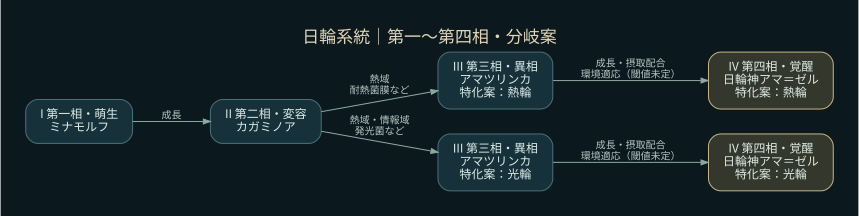

# 20系統の進化・分岐ツリー（A仕様案）

ゲーム実装は進めず、A1.1とB5.1で内容と参照機能を検討するための資料。元FizzBuzzの第一〜第四相の名称を保持する。**枝名・枝数・分岐時期・餌条件・能力傾向は今回の提案であり、元のFizzBuzzに既存の分岐表があると主張しない。**

## ツリーの読み方

- 第一相→第二相は共通の成長経路。第二相→第三相で餌・環境の経験に応じて系統内の特化を選び、第三相→第四相で覚醒する案。
- 基本20系統は固定し、枝を進んでも別系統への変更や仲間関係の変更はしない。
- 元の相の名称と、今回の特化名を分けて併記する。第四相の既存名を新しい別種名に置き換えない。
- どの枝でも生命・鉱物・情報を組み合わせた摂取と環境適応を必要とする案。表の餌は分岐の手掛かりであり、その餌1種類だけで覚醒できる意味ではない。
- 部位別XP・器官レベルを条件にしない。代替となる成長・摂取配合・環境経験の閾値は未確定。数値入力だけでは覚醒しない。
- 条件を複数満たす場合の優先順位、第三相以降の分岐変更可否は未確定。図は分岐を保持する案であり実行規則ではない。

## 全系統の索引

| 系統 | 第一相・萌生 | 第二相・変容 | 第三相・異相 | 第四相・覚醒 | 分岐案 |
|---|---|---|---|---|---|
| [深淵触手](abyss.md) | ミナモルフ | ウロネクト | ノクトラケル | ネフ＝エルド | 潮流捕食 / 深圧保持 |
| [神鳥](myth.md) | ミナモルフ | ミツアシハヤ | カラスヴァ | 天導ヤタリス | 熱翔 / 光冠 |
| [再帰知性](recursive.md) | ミナモルフ | ラムダイル | リスプラトス | ゼータ＝パレン | 再帰記憶 / 分散探索 |
| [光帆](sail.md) | ミナモルフ | セイルルガ | アストレイヴ | ヘリオ＝ヴェルカ | 潮帆 / 光帆 |
| [重力環](gravity.md) | ミナモルフ | トリグラノ | オルビレグス | ゼロ＝ケプレア | 熱環 / 静環 |
| [星晶](crystal.md) | ミナモルフ | プリズメル | ネビュラティス | セレス＝グラシア | 層晶 / 折光 |
| [多眼知覚](manyeyes.md) | ミナモルフ | マガノーヴ | パノプセラ | オムニ＝ノクティス | 潮流索敵 / 情報広域 / 暗所精密 |
| [深殻](abyssshell.md) | ミナモルフ | カルカシェル | アビサルド | ウル＝ダルシェル | 潮殻 / 深殻 |
| [並列生命](parallel.md) | ミナモルフ | コンカリオ | パラレギオン | ゴル＝コンカレス | 熱駆動 / 並列演算 |
| [記憶殻](memory.md) | ミナモルフ | スタックラ | ボロウ＝フェラク | メモル＝クラスト | 記録殻 / 保全殻 |
| [多頭蛇](serpent.md) | ミナモルフ | ミダレクビ | ヤツマガノ | 八星蛇オロマグナ | 潮蛇 / 炎蛇 |
| [日輪](solar.md) | ミナモルフ | カガミノア | アマツリンカ | 日輪神アマ＝ゼル | 熱輪 / 光輪 |
| [反記銘生命](antimeme.md) | ミナモルフ | ノル＝メム | レテグラフ | アネムネシス | 潜在 / 遮蔽 |
| [異化通信生命](valis.md) | ミナモルフ | ノオフィラ | アイオ＝レイ | ヴェイル＝シオン | 受信同調 / 熱光増幅 / 静域遠信 |
| [浮遊傘](jelly.md) | シェルム | ルミクラ | エアロネマ | ルミナ＝アンブラ | 潮傘 / 光傘 |
| [植物共生](kelp.md) | ハナモル | フィトリア | 花冠樹 | フロラ＝ヴァイン | 熱域光合成 / 水域共生 / 情報共生 |
| [星海鯨](whale.md) | ウミモル | ホエリア | 星海鯨 | オルカ＝エオン | 潮海濾過 / 深海巡航 |
| [群体節足](swarm.md) | コロニル | アラクネア | 群星殻 | ミリオ＝コロニー | 連携採集 / 潮間群行 / 熱域装甲 |
| [プラズマ生命](plasma.md) | ヒカリル | プラズミア | 放射生命 | イグニス＝ルーメン | 熱循環 / 静域蓄光 / 情報共鳴 |
| [深淵頭足](cephalopod.md) | マントル | セファリア | 深淵頭足 | クトラ＝マントル | 潮域捕食 / 静域潜行 / 情報擬態 |

全20系統・46本の特化経路案。枝数は環境と系統の特徴に合わせて2〜3本とし、全系統へ機械的に同じ枝名を当てない。

## 日輪系統の例

## ゲーム内から参照する機能

[参照機能の仕様案](../in-game-evolution-viewer.md)。図鑑から全体、個体詳細から現在の系統・相・枝へ移動し、各辺の条件と不足分を確認する。今回は仕様資料のみで、ゲームコードへ組み込まない。

## 出典と判断の境界

既存名称の出典: `gas-fizzbuzz-webapp/src/composite/lineage-definitions.js` と `creature-engine.js` のPHASES。元FizzBuzzの器官条件は、そのまま移植せず代替条件を検討する。既存の承認・検証結果を新しい枝や餌の採用根拠にしない。
