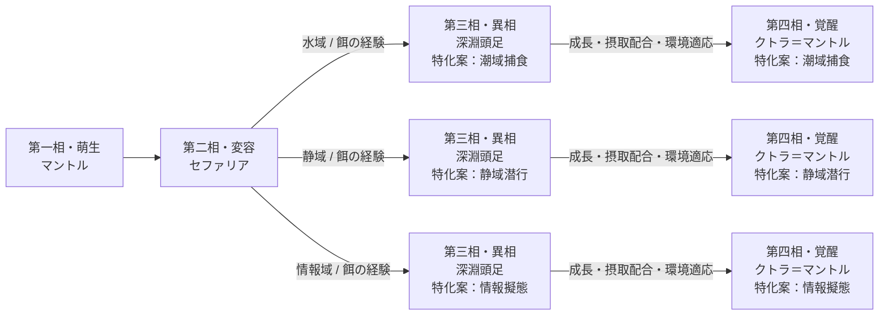

# 20 深淵頭足系統 — 進化・分岐ツリー

系統ID: `cephalopod`。A1.1の仕様案。基本系統は固定し、同系統は仲間。元の特徴: 柔らかい外套と腕がつながる深海生命。

**元定義から保持するもの：四相の名称・系統名。今回の提案：分岐の枝と条件・能力傾向。**

## 環境・餌による分岐の候補

| 特化案 | 経験する環境 | 手掛かりとなる餌差分 | 能力の傾向案 |
|---|---|---|---|
| 潮域捕食 | 水域 | 水生卵・浮遊プランクトン・潮紋片 | 攻撃・採集 |
| 静域潜行 | 静域 | 低代謝微生物・層状石・記憶片 | 省エネ・防御 |
| 情報擬態 | 情報域 | 発光菌・導光鉱・符号晶 | 射程・回復 |

各行は候補条件。必要量・比率・経験ターンは未確定。対応する環境に居続けるだけ、特定の餌だけを食べるだけで第四相へ進める条件にはしない案。能力名は傾向を示し、上昇量や実際の行動効果は未決定。

## 図のテキスト定義

[全20系統の索引](README.md) / [環境別の餌差分](../environment-food.md) / [ゲーム内の系統樹機能](../in-game-evolution-viewer.md)
