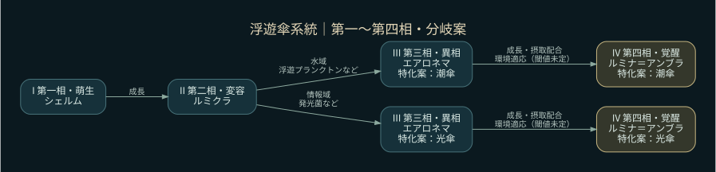
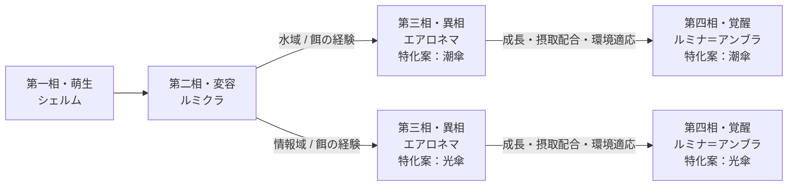

# 15 浮遊傘系統 — 進化・分岐ツリー

系統ID: `jelly`。A1.1の仕様案。基本系統は固定し、同系統は仲間。元の特徴: 傘と触糸が一体となり漂う浮遊生命。

**元定義から保持するもの：四相の名称・系統名。今回の提案：分岐の枝と条件・能力傾向。**

## 環境・餌による分岐の候補

| 特化案 | 経験する環境 | 手掛かりとなる餌差分 | 能力の傾向案 |
|---|---|---|---|
| 潮傘 | 水域 | 浮遊プランクトン・微藻群・潮紋片 | 移動・採集 |
| 光傘 | 情報域 | 発光菌・光藻群・共鳴片 | 回復・射程 |

各行は候補条件。必要量・比率・経験ターンは未確定。対応する環境に居続けるだけ、特定の餌だけを食べるだけで第四相へ進める条件にはしない案。能力名は傾向を示し、上昇量や実際の行動効果は未決定。

## 図のテキスト定義

[全20系統の索引](README.md) / [環境別の餌差分](../environment-food.md) / [ゲーム内の系統樹機能](../in-game-evolution-viewer.md)
