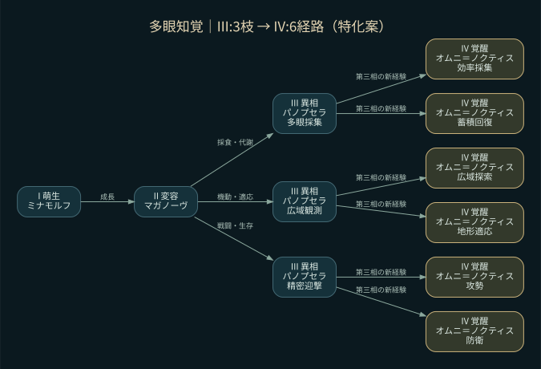
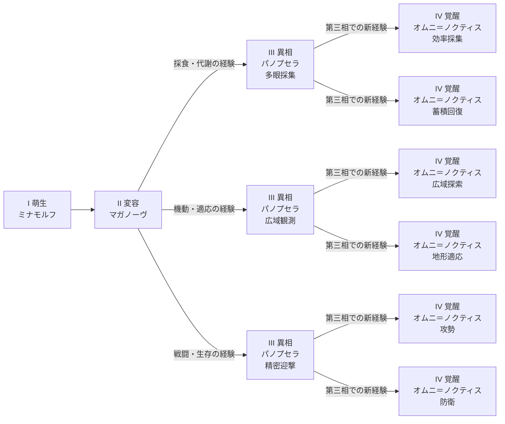

# 07 多眼知覚系統：第三相3枝・第四相6経路

系統ID `manyeyes`。特徴は「巨大な複眼と漂遊する眼群」。基本系統・基礎DNA・仲間関係を保持する。

## 分岐の理由

元の生態傾向を参考にする環境：静域・情報域。対応餌の例：休眠胞子・岩間苔・低代謝微生物、層状石、記憶片。これは既存の環境傾向の参照であり、環境名だけで枝を強制する規則ではない。

| 第三相の特化案 | 分岐する経験の傾向 | 第四相の2方向 |
|---|---|---|
| パノプセラ〔多眼採集／採食・代謝〕 | 実吸収・餌配合・適合環境での資源利用 | 効率採集 / 蓄積回復 |
| パノプセラ〔広域観測／機動・適応〕 | 有効な探索・移動後の成果・消費と環境適応 | 広域探索 / 地形適応 |
| パノプセラ〔精密迎撃／戦闘・生存〕 | 敵との実交戦における有効な攻撃・防御・生還 | 攻勢 / 防衛 |

## 第四相6経路

| 親となる第三相 | 第四相の表記案 | 第三相で新たに必要になる経験 |
|---|---|---|
| 多眼採集 | オムニ＝ノクティス〔効率採集〕 | 消費に対する吸収が高く、安定して資源を獲得 |
| 多眼採集 | オムニ＝ノクティス〔蓄積回復〕 | 消耗後の回復と栄養維持を両立 |
| 広域観測 | オムニ＝ノクティス〔広域探索〕 | 新しい土地への移動が採食・生存につながる |
| 広域観測 | オムニ＝ノクティス〔地形適応〕 | 特定の生息地で効率よく移動・採食・生存 |
| 精密迎撃 | オムニ＝ノクティス〔攻勢〕 | 有効な脅威排除と交戦後の維持を両立 |
| 精密迎撃 | オムニ＝ノクティス〔防衛〕 | 損害の軽減・回避・回復によって生き残る |

栄養・成長・環境適応の共通条件に加え、親となる第三相で新たに得た経験を比較する案。相の既存名称を残し、特化は別ラベルとする。具体的な点数・閾値・見た目・能力補正は未確定。戦闘しない個体も採食・機動から第四相へ進める。第三相から繁殖でき、第四相を待つ必要はない。

## テキストで確認する図

[全20系統](README.md) / [分岐ロジック](../branching-rules.md) / [説明シート](../explanation-sheets.md)
