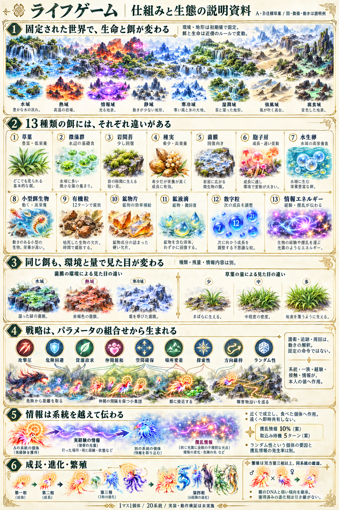

# 生態シミュレーション：仕組みと生態

**説明資料としてのモック。** 図・配置・数値・動きは説明例であり、ゲーム画面の配置指定や実行結果ではない。A/B草案をまとめたもので、実装・ゲーム動作・性能・創発は未検証。

## 1. 何を観察するゲームか

初期値から生まれた20系統の生命が、餌を食べ、他個体や情報の影響を受け、成長・進化・繁殖する。どの個体・一族・系統が残り、どのような動きが生まれるかを観察する。

一マス最大一体。同系統は一族が違っても仲間。環境・地形・障害物は初期値で決まり、通常ターンでは変化しない。水域・熱域・情報域・静域・寒冷域・湿潤域・強風域・腐食域の8環境案を、一続きの地形へマスごとに分布させる。系統の適性で攻防・移動消費が異なるが、苦手環境だけで隔離・即死にしない。

変動するのは餌と生命。周囲8マスの局所条件と同期更新を基本にする。餌のB3/S23へ種類別の周期や成立条件を重ね、生物は局所的な採食・移動・攻防・出生と密度負荷を扱う。厳密なConwayのルールへ加えた変更点は、具体化仕様に明示する。

## 2. 餌は採りやすさ・量・栄養・動きが違う

| 餌 | 説明資料で伝える特色 |
|---|---|
| 草葉 | 豊富・動かない・低栄養。量を食べて補う基礎植物 |
| 微藻群 | 水辺の基礎食。まとまって採れる |
| 岩間苔 | 岩に沿う植物性の餌。低栄養だが少し回復 |
| 種実 | 植物の近くに成立。少量で高栄養 |
| 菌膜 | 岩面の薄膜。負傷からの回復向き |
| 胞子房 | 成長向き。近傍による出現・消失が速い |
| 水生卵 | 水域限定、動かない高栄養食。主役の子とは別 |
| 小型餌生物 | 高栄養で、2ターンごとに局所移動。捕獲に手間がかかる |
| 有機粒 | 汎用食だが、誕生から12ターンで腐敗 |
| 鉱物片 | 鉱物を効率よく補う。空腹・全身成長は補わない |
| 鉱液滴 | 鉱物に加えて微回復・成長を補助 |
| 数字粒 | 少量のEと、次の有機食の成長効果の調整 |
| 情報エネルギー | 実経験・撹乱などの内容が行動パラメータへ作用 |

植物の草葉・藻・苔、菌類の菌膜・胞子、動物的な小型餌生物を区別する。動く餌も資源の近傍成立を通し、移動ではIDと残量を移すだけで複製しない。主役の人口・出生近傍へは加算せず、DNA・雌雄・進化・戦略は持たせない。

### 同じ餌でも見た目は変わる

環境で材質・模様・まとまりを変え、残量で被覆・粒や核の密度を変える。菌膜なら水域は湿った緑、熱域は赤褐色、寒冷域は霜を帯びた膜。情報は環境に応じた縁や帯を持つ、柔らかい光霧/核として表す。

少/中/多は各種類の上限に対する割合。例えば基礎植物の上限20では1〜5/6〜13/14〜20、情報の上限12では1〜3/4〜8/9〜12、動く餌の上限6では1/2〜4/5〜6。残量と、数字の値/情報の経験内容は別項目。

## 3. 戦略は選ぶ命令ではなく、動きの結果

本人の9パラメータは、攻撃圧・危険回避・資源欲求・仲間親和・空間確保・場所愛着・探索性・方向維持・ランダム性。系統や親から初期化し、自分の経験・個体接触・情報摂取で同じ値を修正する。

これらが周囲8マスと本人の状態への反応を重み付けし、移動・停止・隣接攻撃・その場の防御という基本動作へ直接作用する。攻撃/逃走/護衛/周回などの戦略モードを選択しない。

- 仲間親和と空間確保が共に高い場合、間隔を保つ集団に見える動きを狙う。
- 攻撃圧と危険回避が共に高い場合、接近と退避を繰り返す動きを狙う。
- 場所愛着・方向維持と資源配置の組合せから、餌場や障害物の周辺を巡る動きを狙う。
- ランダム性は成立した候補への揺らぎ。初期値から再現でき、通行不可・費用不足などは無視しない。

これらは創発の説明例で、特定の動きを保証する専用ルールや実測結果ではない。

## 4. 情報は経験を個体の外へ残す媒体

**有効な行動結果 → 局所に残る経験要約 → 近傍則で成立する情報エネルギー → 別個体の摂取 → その個体のパラメータ変化。**

情報は滞留・浮遊する光霧・帯・発光核で、硬い鉱物とは区別する。どの系統も摂取でき、局所伝達の繰り返しから広がる。遠方へ即時共有せず、DNA・身体能力・相・進化枝はコピーしない。

経験情報とランダム内容の撹乱情報を区別する。撹乱率10%、内容取込み待機5ターンは数値草案。個体のランダム性パラメータと、餌の撹乱率は別のもの。内容をランダム化しても、情報餌を無条件生成するわけではない。

## 5. 成長・進化・繁殖

全20系統で第一相・萌生→第二相・変容→第三相・異相→第四相・覚醒を保つ。第三相は3枝、各枝から第四相へ2方向、計6経路。部位別XPは持たない。全身成長・鉱物蓄積・相に入ってからの本人の実成果が条件となり、情報を食べただけでは進化しない。

繁殖は双方第三相以上の同系統の雄雌が候補。状態・待機・近接・局所出生・空きマスの条件も必要。子は同系統の第一相から始まり、親のDNAと弱い傾向を継承する。親の獲得済み相・枝・経験履歴は継承しない。

## 6. 説明資料の範囲

説明シートは、全体のつながりと餌の見分け方を合わせる資料。20系統の全造形、全餌の8環境×残量全差分、ゲームの操作配置を確定したものではない。紙面にない細かい数値や条件は下記を参照する。

[具体化仕様v2](concrete-rules-v2.md) / [13種類の個別生態・量・周期](food-ecology.md) / [餌の近傍更新](food-cellular-rules.md) / [系統樹](evolution-trees/README.md)

## 食性と観測を具体化

[食性・捕獲・生存観測の補足資料](diet-and-observation.md)。共通資源を系統とDNAにより異なる効率で利用し、動く餌は同じマスで捕獲する。標準1000ターンごとに個体数・出生・世代交代を比べる。既存の説明シートと併読する文章資料で、追加画像生成は行っていない。

## 基本動作と生態の拡張検討

[基本動作の条件を具体化](basic-dynamics-decisions.md)：餌の枯渇、出生B3、実際の損害/軽減・生還、局所の接触学習と情報発信。[拡張候補の比較](simulation-expansion-candidates.md)：射程・感知・射線・行動間隔・代謝・食物網など。拡張候補は未採用で、現行仕様の変更と区別する。

## 多数個体の具体化

[1マス1個体を維持する多数個体のA/B仕様](many-individuals.md)。標準案320体/80×56、大規模目標1280体/160×112。画面内外を同じ局所規則で更新し、点/簡略形/詳細形を表示倍率で切り替える。旧40×28固定/80体固定より本案を優先。いずれも未実装の設計目標で、性能実績ではない。

## 初期配置の偏りとモード

[初期配置モード](initial-placement-modes.md)：自然な偏りを許容し、偏りなし/系統少なめ/集中配置等で制御。参加系統・総数・人数配分・空間配置・資源保証を分ける。既存画像は設定機能の実装を示すものではない。

## 進化するほど強くなる20系統

[四相の共通強化と系統固有特性](lineage-strength-and-evolution.md)。元のライフゲームの繁殖/防御回復/移動/省エネルギー/攻撃/遠隔/連携/採取を参考に、20系統の固有特性を提案。相が進むほど共通A/Dと固有特性が強くなる。遠隔等の追加機構は候補と区別し、未実装。

[系統別の繁殖・寿命・必要資源・移動](lineage-physiology-and-movement.md)：高繁殖/短命、長寿/低消費、重い材料要求、段階的な二歩移動等を具体化。既存の全系統共通値を更新する未実装草案。

## 食物網・寄生・光合成・モーション

[追加の生態関係と行動表現](ecological-relations-proposal.md)。寄生2系統の宿主移行/宿主依存分岐、光合成、庇護、簡単な文脈情報、確定イベントのモーション。分割確認に従うA/B草案で、コードや画像を作成した報告ではない。

## 生物間捕食と生態シミュレーション

[有限死骸・捕食・宿主移行](predation-and-ecosystem.md)を最新追加草案とする。呼称は生態シミュレーション、セル局所更新は基盤。攻撃時に栄養を奪わず、死亡後の有限資源を実際に採食する。死骸の栄養回収と寄生ペイロードの消費を区別。コード/画像は作成していない。
