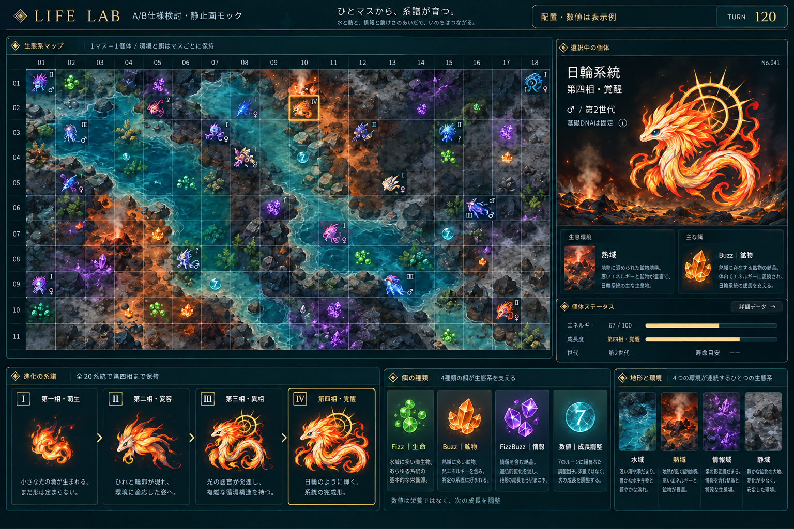

# A/B仕様検討用の静止画

現在の作業はA仕様・B機能の検討のみ。実装再開はユーザー許可待ち。実装コード・テスト・実行物の更新は行っていない。

- 第一相・萌生、第二相・変容、第三相・異相、第四相・覚醒を全20系統で保持する。画像の4相は日輪系統の代表例。
- 一続きの背景に、各マスの水域・熱域・情報域・静域の見せ方を提案する。
- Fizz=生命粒、Buzz=鉱物片、FizzBuzz=情報結晶、数値=数字の印の4入力を提案する。数値は通常の栄養ではない。
- 静止画は画像生成による造形・配置の案。元のFizzBuzz資産をそのまま切り出した一覧や、実際のシミュレーション結果ではない。画面の数値は表示例。

仕様正本はA1.1/A1.2、機能はB5。詳細な覚醒条件、地形と餌の造形、表示密度は認識合わせ中。
