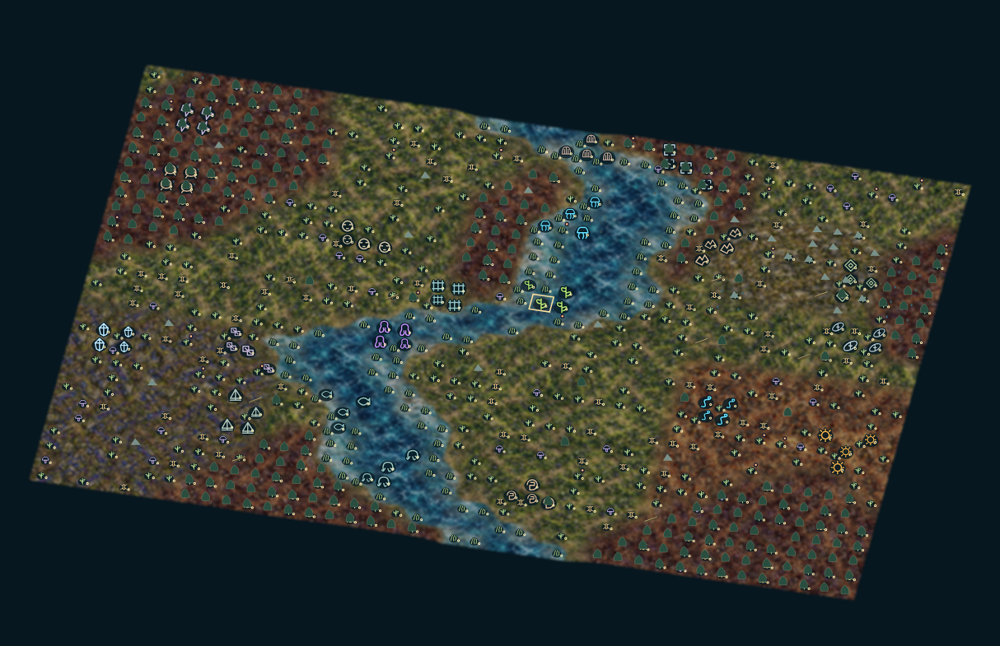
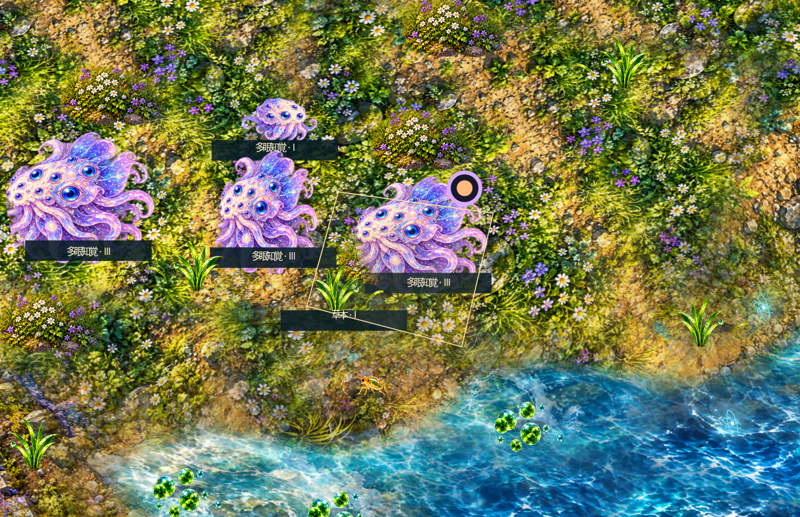
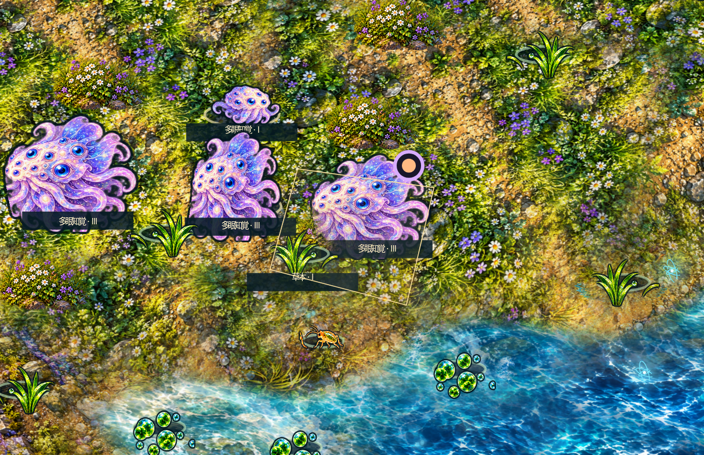

# app3.3.0 生物強調・通常生存・接触寄生の実測

契約: operations/plans/presence-contact-v3.3.md。仕様: ordinary-survival-v2.1 / parasite-contact-v2.0。Linux Node24 / Chromium HTTP loopback。実行主体Codex、結果分類は機能検査成功・長期バランス部分改善。原画21PNGは前版と同一、強調表示は生態状態を変更しない。外観承認は利用者判断。

## 実画面

同じ盤面の強調OFF/ONを比較。画像はゲームの実描画。近景の相・年齢・寄生は描画確認用fixtureであり自然進化の証明ではない。

| 遠景OFF | 遠景ON |
|---|---|
|  |  |

| 近景OFF | 近景ON |
|---|---|
|  |  |

## 通常生活

ordinary-before/after.json: 一主系統40体、river40×28、life/1、P/Qなし、実製品の餌捕食は有効、500ターン。前対照は通常生活調整前の製品コード（接触追加済みだがP/Q無効）。餓死合計173→54、500時存続2/5→4/5。現在の終端はmyth53、recursive29、crystal9、kelp101、swarm0。寿命による死亡と出生があるため個体の不死化を意味しない。維持費0.60・移動費0.65・孤立費0.1、栄養不足に応じた探索、刈取り後の光利用下限0.5を適用。無償補充なし。

## 混合競争

before-survey.jsonはapp3.2 b3d2711の既存記録、after-survey.jsonは同じ10初期条件（6地形、40×28、5主系統80体、自然配置、保証なし）各500ターン。全滅1→0、導入延べ50系統の300〜500毎ターン連続存続15→41。現行主生物の死因は戦闘107・餓死155・寿命887。戦闘主体という目標には未達。終端の系統構成は複数あるが、系統別10試行や全20系統の目標率を認定しない。

Pは500時0/10→10/10で存続。10条件は初期Qがすべて0なのでQ維持の根拠にしない。q-survey.jsonは先に初期Q陽性を選んだ2条件の新旧比較。両条件とも現行Qは100時まで増殖するが500時0。Q長期維持は未達。接触感染は反復3回、親予算の有償娘群体、待機18/終宿主成熟後3、同日連鎖禁止。終宿主完走と単なる存続を混同しない。

## 検査と有効性

unit-final.log: 回帰検査113件成功（失敗0）。presence-report.json:13画面項目、生態指紋一致・全位置・宿主P/Q・輪郭キャッシュ・200静止更新で追加全描画0。usability-report.json:19項目。overview-report.json:15項目（同一描画コード、植物回復調整前）。source-hashes.jsonは対象ソース・検査・依存・仕様のSHA256。入力は各JSON内。実装・期待値・入力・依存・環境変更で該当証跡は再検証。

windows3.2.jsonは前版b3d2711の実exe起動成功受領。現行3.3のWindows実exeは未確認で、Linux結果から認定しない。CIに生物強調検査を追加。

## 次の調整

群体型の世代交代、鉱物主体の有機栄養確保、Qの生活環、戦闘と通常死亡の比率を優先する。係数を変えて全系統の自動存続を保証せず、固定条件と別初期値で確かめる。正式Node状態は草案を維持。
