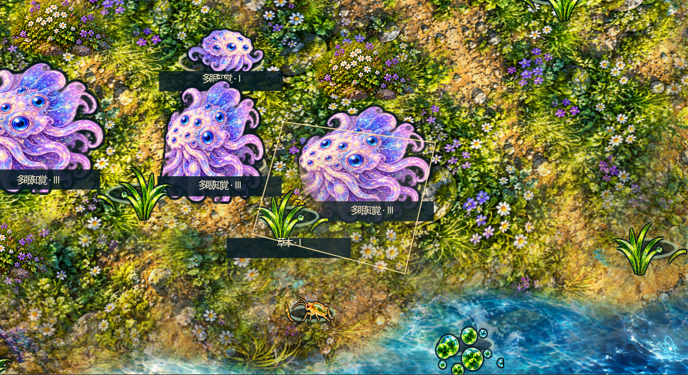
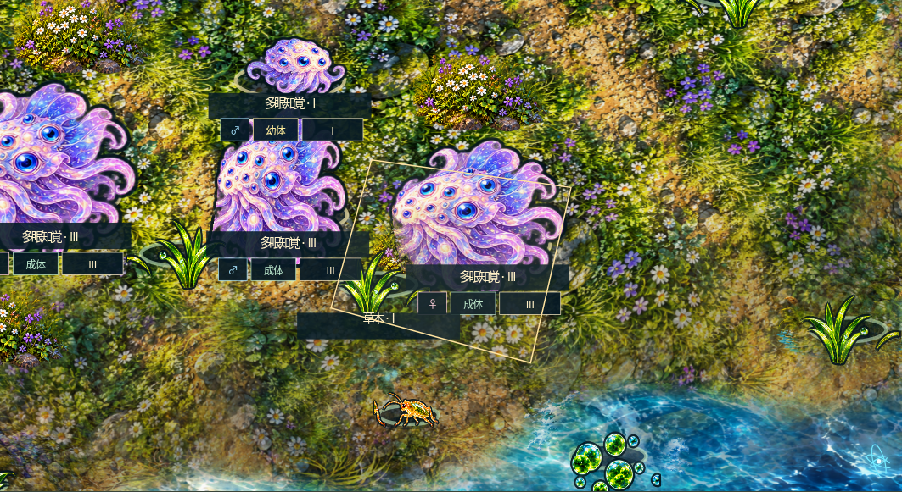
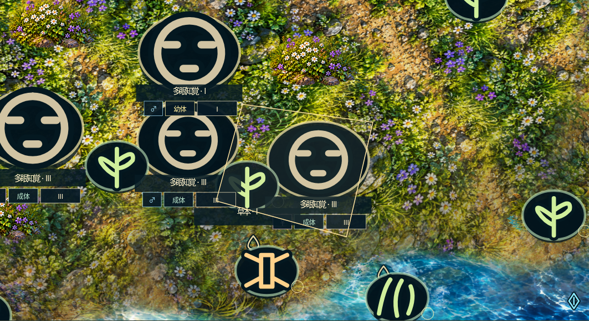
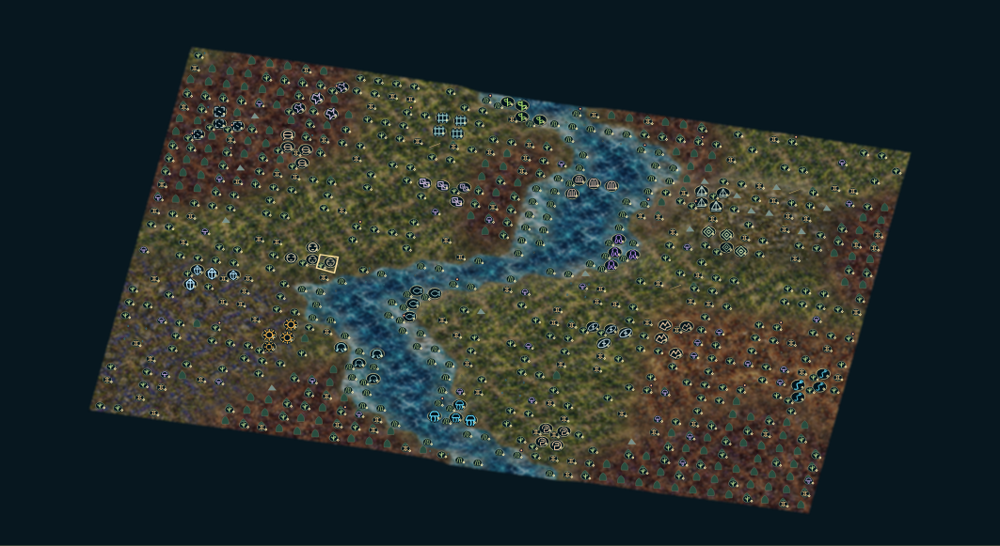

# app3.5.0 近景の記号・状態札・背景の起伏

現行実装と比較画像の入口。契約: operations/plans/terrain-symbols-v3.5.md。FLOW-04/05→D9→FLOW-08/E6→Manifest反映。Linux Node24/Chromium HTTP loopback、実行主体Codex、記録UTC: 2026-10-17T18:15:32.757201+00:00。結果分類は機能検査成功、外観の最終承認とは区別する。Windows3.5実exeは未確認。

## 操作と表示

遠景では記号へ強制切替。近景は既定で詳細、「生物を記号表示」で記号も選べる。ズーム/全体/近景切替で選択を保持する。近景の背景は両方式とも精細な原画と地物を使う。

「状態マーク」は近景の主生物に、性別♂/♀/—、幼体/成体/老齢、I〜IV相＋確定済み分岐を別々の札で示す。例: III-C、IV-C2。倍率100未満は選択個体へ限定する。遠景へ全札は敷き詰めず既存の系統記号・年齢印・P/Qを保つ。低HP25以下/低E15未満には!警告。名前と状態札は生物本体の後に描き、前景の本体に隠されない。非対応の年齢データは未判定とし成体と推測しない。切替で隠すこともできる。

戦闘/摂食/移動/育児/繁殖は確定したイベントの既存表示を利用。体力/栄養の詳細と繁殖階級は個体観察で確認する。相・年齢だけでは配偶者/空き枠/出生予算が決まらないため、「繁殖可能」を断定するマークは付けない。

## 実画面

同一初期値presence-review、40×28、river、80主生物。比較前後で同じ6個体を明示的なIII相/年齢50へ置く造形fixture。自然進化や生存率の証拠ではない。前後とも1450×1000のブラウザで盤面のみ撮影。原画21PNGは変更していない。

| 変更前の近景 | 今回の詳細近景 |
|---|---|
|  |  |

| 今回の記号近景 | 今回の遠景 |
|---|---|
|  |  |

## 背景

既存の草花/林床/岩/土/水/寒冷/熱/情報/腐食の絵を維持。材質重みのみ3×3の連続近傍場へならし、セル境界をまたいで移行させる。水陸の実輪郭は別に保持。表示上の岩の高さと緩い起伏、同じ投影面に由来する斜面の明暗・岸の陰影を加える。生物の足元、資源、地物、選択は同じ投影を使い、通行障害や環境の実値を増やさない。

## 検査と適用範囲

report.json: 状態札を含む23項目。雌雄/無性×3年齢×4相の36状態を実際のCanvas文字描画で確認。近景両方式、遠景強制、設定保持、全位置、生態指紋独立、P/Q、低体力警告、狭い画面。200静止更新で追加全面描画0。材質は境界両側の代表重み0.18/0.50/0.82、境界の微小差0.000128で連続。片側光と逆斜面の陰影を区別。

habitat-ui-report.json:20項目（8環境・素材・水陸・遮蔽）。overview-ui-report.json:15項目（全位置・資源・記号）。graphics-rebuild-report.json:18項目（投影・造形・重複・確定動作・宿主）。unit.log: 投影/Manifestの4検査。manifest-final.logは59NodeのID/階層/参照/草案を照合。描画の機能検査は外観の承認や全端末での性能保証ではない。

biological-identity.jsonは3.4との生態11ファイル＋再生指紋の12SHA一致を記録。前版E5の計算範囲を継承し、生態バランスを改善したとは主張しない。今回の表示変更を理由に長期生存の同じ試行を再実行しない。

source-hashes.jsonが対象実装・仕様/契約・検査・依存を特定する。実装/素材/仕様/入力/期待値/依存/環境変更で該当検証を更新する。実行環境の再起動後に最終画面を再取得した。途中候補の画像を現行の承認済み画像として扱わない。正式Node状態は草案のまま。
